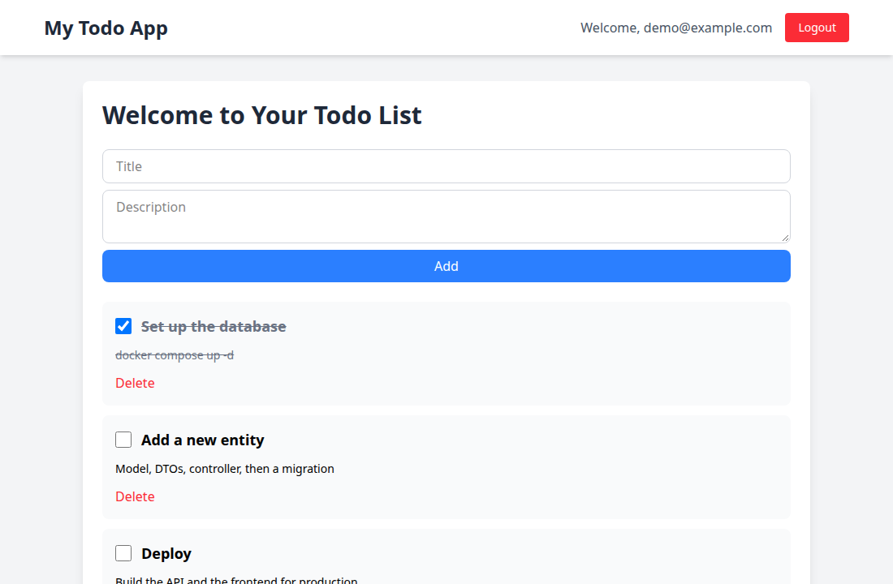

# dotnet-react-starter

[](https://github.com/salahALKT/dotnet-react-starter/actions/workflows/ci.yml)

A starting point for full-stack web apps: an **ASP.NET Core** API with JWT authentication and PostgreSQL, and
a **React** frontend built with Vite and Tailwind. The example app is a per-user todo list. It's small enough to
read in one sitting, and it has the parts most apps need: sign-in, tokens, roles, a database with migrations, and
a frontend that talks to a protected API.



## What's inside

**API** ([`api/`](api)): ASP.NET Core 10, controllers
- Sign-up and login with ASP.NET Core Identity, JWT access tokens and refresh tokens (`/api/auth/...`).
- Roles: an `Admin` role is created at startup, with a seeded admin account.
- Entity Framework Core with PostgreSQL. Migrations are applied automatically in development.
- A protected CRUD resource (`/api/todos`): each user only sees and edits their own todos.
- OpenAPI document and Swagger UI in development, at <http://localhost:5136/swagger>.

**Frontend** ([`web/`](web)): React 19, React Router 7, Vite, Tailwind CSS 4
- Login page, protected routes and an auth context that stores the tokens and refreshes them.
- Data loading and updates through React Router loaders and actions.
- The Vite dev server proxies `/api` to the API, so there is no CORS setup in development.

## Running it locally

You need the [.NET 10 SDK](https://dotnet.microsoft.com/download), [Node.js 20+](https://nodejs.org) and
PostgreSQL. The easiest way to get PostgreSQL is Docker.

**1. Start the database**

```bash
docker compose up -d
```

This starts PostgreSQL on port 5432 with the credentials from `api/appsettings.json` (`postgres` / `postgres`,
database `tododb`). If you already have PostgreSQL installed, create a `tododb` database and update the
connection string instead.

**2. Start the API**

```bash
cd api
dotnet user-secrets set "JWT:Secret" "$(openssl rand -base64 48)"   # once: the key that signs the tokens
dotnet run --launch-profile http
```

On first start the database tables are created and an admin account is seeded:
`admin@example.com` / `Admin@123`. The API listens on <http://localhost:5136>.

**3. Start the frontend**

```bash
cd web
npm install
npm run dev
```

Open <http://localhost:5173> and sign in with the admin account.

[`api/TodoApi.http`](api/TodoApi.http) has example requests for every endpoint. Run them from VS Code with the
REST Client extension, or from Visual Studio.

## Using it as a template

To add a new resource, follow the todo example:

1. Add a model in `api/Models/` and a `DbSet` for it in `api/Data/ApplicationDBContext.cs`.
2. Add request DTOs in `api/Models/DTOs/` and a controller in `api/Controllers/`, marked `[Authorize]`.
3. Create a migration: `dotnet ef migrations add AddMyResource` (needs `dotnet tool install --global dotnet-ef`).
4. Add a route with a loader and an action in `web/src/App.jsx`, and a page in `web/src/Pages/`.

Before deploying anywhere:
- Use a real database password.
- Set `JWT:Secret` through an environment variable (`JWT__Secret`).
- Remove or change the seeded admin account in `api/Data/DbSeeder.cs`.
- Set `ValidIssuer` / `ValidAudience` in `appsettings.json` to your real URL.

## Layout

```
api/                 ASP.NET Core API
  Controllers/       auth, users, todos
  Data/              EF Core context and startup seeding
  Migrations/        database schema history
  Models/            entities and DTOs
  Services/          JWT creation and validation
web/                 React frontend
  src/Contexts/      authentication state
  src/Pages/         login and home pages
  src/Components/    layout, todo item, todo form
docker-compose.yml   PostgreSQL for development
```

---

*Cleanup and presentation (merging the two original repos, the .NET 10 upgrade, this README, CI and a few
fixes) were done with the help of Claude (Anthropic) in 2026. The application itself is my own work.*
